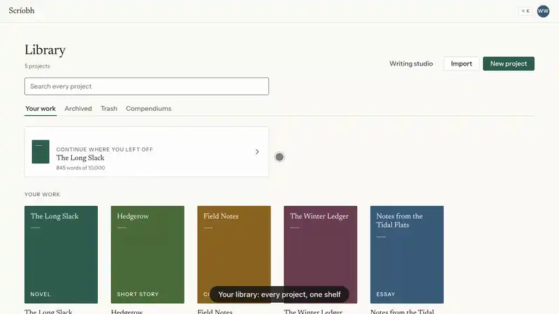
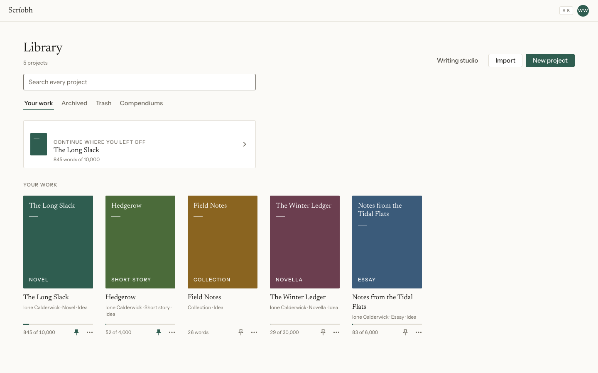
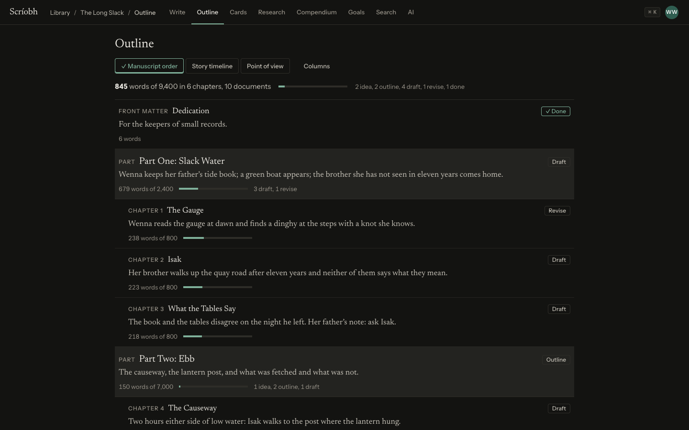
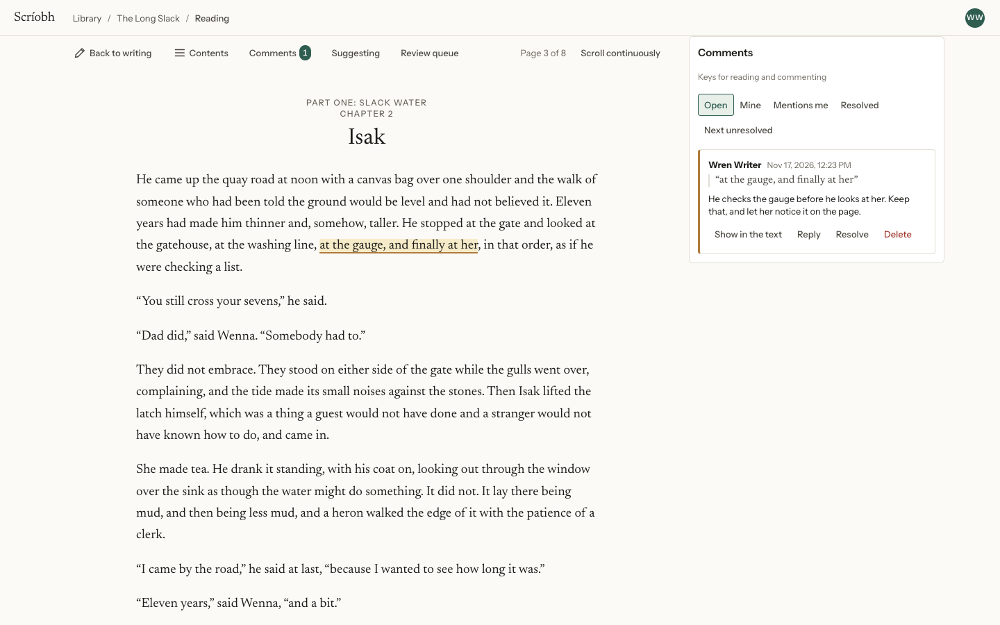
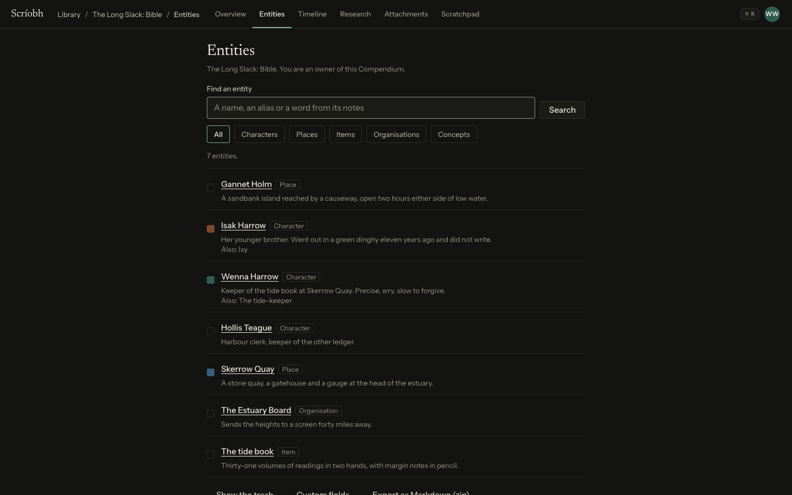
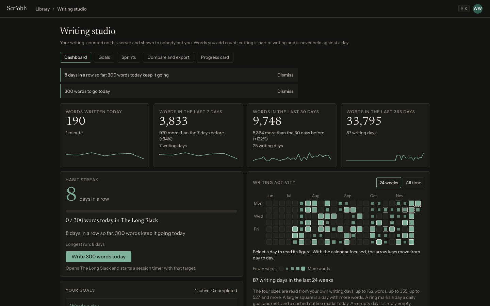
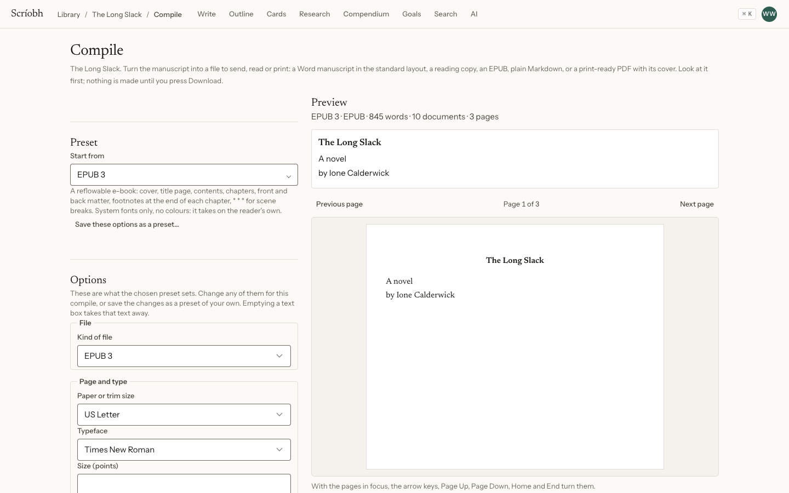
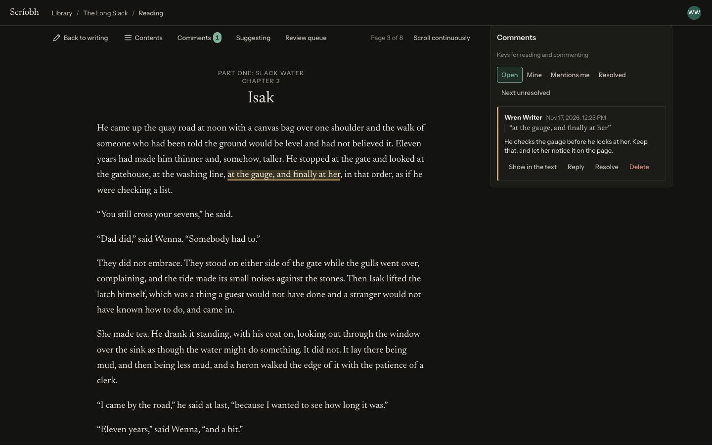

# Scríobh

**A quiet room for the long thing you are writing.** Self-hosted, private, and built for the whole life of a piece of work: a blog post, an essay, a report, a novel.

Scríobh (Irish, *write*) is a long-form writing application that you run on your own machine or home lab, or open as a desktop app. One Go binary, one SQLite file, your words on your disk. Sign in with the identity provider you already have. Markdown is always underneath. Bring your own AI keys if you want AI at all, including a model on the same box. Keep a plain-text copy in a Git repository you control.

No account on someone else's server. No telemetry. No editor that phones home mid-sentence.

[Install](#install) · [Releases](https://github.com/crueber/scriobh/releases) · [Configuration](#configuration) · [Desktop app](#the-desktop-app) · [How it works](#how-it-works) · [Docs](#documentation) · [Status](#status-and-what-is-not-verified)

<p align="center">
  <a href="docs/media/demo.webm"></a><br>
  <a href="docs/media/demo.webm"><b>&#9654; Watch the 46-second demo</b></a> &middot; the library, writing, alternatives, outline, studio and an EPUB compile, with captions, no sound (<a href="docs/media/demo.mp4">MP4</a>)
</p>

<p align="center">
  <a href="docs/media/library-light.png"></a>
  <a href="docs/media/write-dark.png"></a>
</p>

<p align="center">
  <a href="docs/media/alternatives-light.png"></a>
  <a href="docs/media/outline-dark.png"></a>
</p>

<p align="center">
  <a href="docs/media/studio-light.png"></a>
  <a href="docs/media/compile-dark.png"></a>
</p>

<details>
<summary>More screenshots</summary>

<p align="center">
  <a href="docs/media/review-light.png"></a>
  <a href="docs/media/compendium-dark.png"></a>
  <a href="docs/media/library-dark.png"></a>
  <a href="docs/media/write-light.png"></a>
  <a href="docs/media/outline-light.png"></a>
  <a href="docs/media/studio-dark.png"></a>
  <a href="docs/media/compile-light.png"></a>
  <a href="docs/media/review-dark.png"></a>
</p>

<p align="center">
  <a href="docs/media/phone-write-light.png"></a>
  <a href="docs/media/phone-write-dark.png"></a>
</p>

</details>

<p align="center"><sub>The book in these pictures, its author and its people are invented. The screenshots and the video are made by <code>scripts/readme-media.mjs</code>; see <a href="docs/media/README.md">docs/media</a>.</sub></p>

## Why Scríobh

Most writing tools are either note apps with a publish button or desktop word processors with a sync problem. Neither holds a manuscript. Scríobh is organised around the project: a manuscript tree, a plan beside it, a cast of characters underneath it, and a revision of every word.

The commitments that decide arguments (the full list is in [AGENTS.md](AGENTS.md) and [docs/VISION.md](docs/VISION.md)):

- **The writing surface is sacred.** Nothing animates, reflows or interrupts while you type. Generated text is never inserted without an explicit accept, and live updates never overwrite what you have not saved.
- **OIDC only.** No local passwords, no reset flow, no second factor of its own. Your identity provider owns who can sign in. The desktop app does not bypass this: it runs a real embedded OpenID Connect issuer on the same code path.
- **Private by construction.** No analytics, no telemetry, no external CDNs or fonts, no error-reporting service, and no outbound request you did not configure. AI is opt-in per project, previewed before anything is sent, and can be forced to a local model.
- **Editorial before generative.** Outline, entities, timeline, research, revisions and compile do not depend on AI. AI can be switched off and the book stays whole.
- **Markdown, in a database you can read.** The database is canonical; a read-only Markdown copy of every project is written continuously, so `grep`, `git` and a text editor always see your work. Alternatives to a wording are annotations on ordinary Markdown, so exports read as plain text.
- **Git is push-only.** Scríobh never pulls. Import is the only way a remote's text enters it.
- **Small enough to trust.** One binary, one data directory, no queue, cache or search service. No gradients; both themes are designed, and contrast is checked by a script.

## What is in it

- **Writing and structure.** A server-rendered writing surface over a ProseMirror editor with a Source view of the same Markdown, an outline with synopses and targets, wiki links and backlinks, versions you can compare and restore, search, light and dark themes, and an installable app shell with an offline page. Alternatives, ghosting, the stash and the Lab keep other wordings beside the chosen one.
- **The Compendium.** Entities, aliases and relations, a timeline with continuity checks, research notes and boards, shared across projects.
- **The Writing Studio.** Goals counted in words added (never net words, and nothing is called missed or failed), streaks, sprints, a pace estimate and an activity calendar, computed on your server and nowhere else.
- **Review and sharing.** Comments anchored to the text, suggestions an editor accepts or rejects, read-only or comment links for guests, and an administrator console.
- **Output.** Compile presets (US and UK manuscript DOCX, styled DOCX, EPUB 3, Markdown), print-ready PDF with covers, a submission bundle, HTML export, and static site publishing.
- **Going in and out.** Import from a folder, a Git repository, Obsidian, Word (tracked changes become suggestions), Scrivener, WordPress, Ghost, an EPUB or a PDF with a text layer; a continuous Markdown mirror; push-only Git sync with deploy keys and several remotes; backup and restore.
- **AI, optional.** A local Ollama or any OpenAI-compatible server, OpenRouter or OpenCode; a per-project policy; a preview of the exact request; budgets. Nothing is written into a chapter without an explicit accept.
- **Agents and integrations.** One op registry behind the pages, a REST API, a scoped CLI (`scriobh-cli`) with a generated skill, an MCP endpoint and signed webhooks.
- **A desktop app.** The same server binary in a [Tauri](https://tauri.app) window, with no server to run and no identity provider to set up.

Every feature, with its priority and phase, is in [docs/FEATURES.md](docs/FEATURES.md); the things deliberately not built are in [§ V](docs/FEATURES.md#v-deliberate-non-features). Scríobh is not a notes app, not a real-time collaborative document, not encrypted at rest (protecting the volume is your job), not a publishing platform, not an AI book generator and not multi-tenant SaaS; see [docs/OVERVIEW.md](docs/OVERVIEW.md#what-scríobh-is-not).

## How it works

```
Browser (HTMX shell + ProseMirror)        Desktop window (Tauri shell)
        │                                          │  127.0.0.1, one origin
        └────────────────────┬─────────────────────┘
                             ▼
      Go binary ── op registry ──┬── HTML fragments
         │                       ├── REST /api/v1
         │                       ├── scriobh-cli + API keys
         │                       └── MCP server (agents)
         │
         ├── SQLite (WAL)   data/scriobh.db       canonical
         ├── Files          data/files/…          images, covers, imports
         ├── Mirror         data/mirror/…         every project as plain Markdown
         ├── Git            push-only: mirror → a repo you own; import from a repo
         └── AI (optional)  openrouter │ opencode │ openai-compatible │ ollama
```

Every write is one registered operation, rendered as an HTML page, a REST route, a CLI command and an MCP tool, so an agent holding a scoped key does what a person does and nothing more. The stack is Go (standard library `net/http`, pure-Go `modernc.org/sqlite`, no CGO), server-rendered HTML with HTMX, a small amount of vanilla JavaScript, and one pinned ProseMirror bundle. No npm at runtime, no client-side router, no framework. The reasons are in [docs/ARCHITECTURE.md](docs/ARCHITECTURE.md).

## Install

Pick one: the container image, a binary built from source, or the desktop app. Tagged versions, with their notes, are on the [releases page](https://github.com/crueber/scriobh/releases), where the prebuilt server and CLI binaries (Linux, macOS and Windows; unsigned, with a `SHA256SUMS.txt`) and the Linux `.deb` are also attached. The first two need an OpenID Connect provider you already run (Passage, Authentik, Keycloak, Pocket ID, Authelia and so on). The desktop app needs none.

> **What has been run.** The binary and its commands, the development sign-in and the REST API have been run. The container image is built and published by CI, and its job checks the image's user and that the production binary refuses the development issuer, but the server in the image has never been run to serve, and the compose files only parse. No real identity provider has been registered against this build. Details: [Status](#status-and-what-is-not-verified).

### Just look at it

No identity provider and nothing to register. The development build has a built-in sign-in for three fixed test users (`admin@dev.scriobh`, `writer@dev.scriobh`, `reader@dev.scriobh`). It must never be exposed to a network.

```sh
make run                       # Go 1.27.4 or newer; prints LISTEN http://127.0.0.1:<port>; data in ./data
# or
docker compose up --build      # then open http://localhost:8080 and pick a test user
```

### Container image

CI publishes the production image to the project's container registry, for example as `ghcr.io/crueber/scriobh:latest`. The tags are the short commit SHA, the release tag's own name for a `v*` tag, and `latest`, which moves; for anything that must not change under you, pin a release tag from the [releases page](https://github.com/crueber/scriobh/releases) or a SHA. If the registry refuses an anonymous pull, run `docker login ghcr.io` first.

A deployment that should follow new builds pins `tag@sha256:…` in its own manifest and rewrites that one line when a new digest appears. Comparing digests rather than tags is what makes `latest` safe to follow: the tag may move, but the bytes a running task names do not.

1. **Register Scríobh with your identity provider** (see [Sign-in](#sign-in-register-an-oidc-client) below) and copy the issuer URL, client id and client secret.
2. **Write `.env`** (one `NAME=value` per line, comments on lines of their own, no `$` in values):

   ```
   SCRIOBH_BASE_URL=https://write.example.com
   SCRIOBH_OIDC_ISSUER=https://auth.example.com/application/o/scriobh/
   SCRIOBH_OIDC_CLIENT_ID=paste-the-client-id
   SCRIOBH_OIDC_CLIENT_SECRET=paste-the-client-secret
   SCRIOBH_SECRET_KEY=paste-the-output-of-openssl-rand-hex-32
   ```

   Make the key with `openssl rand -hex 32`, and keep a copy somewhere that is not this machine: it seals the credentials Scríobh stores and is not in backups.
3. **Run it.** The image runs as uid 65532 with a read-only root filesystem and writes only under `/data`; a new named volume inherits that ownership.

   ```sh
   docker run -d --name scriobh --restart unless-stopped \
     --read-only --tmpfs /tmp --cap-drop ALL --security-opt no-new-privileges:true \
     -p 127.0.0.1:8080:8080 -v scriobh-data:/data --env-file .env \
     ghcr.io/crueber/scriobh:latest
   ```

4. **Check it.** `docker ps` shows `healthy` after about 30 seconds and `curl -s http://127.0.0.1:8080/healthz` prints `{"status":"ok",...}`. If it exited, `docker logs scriobh` names the problem in plain words, and `docker run --rm --env-file .env ghcr.io/crueber/scriobh:latest config check` lists everything that is missing.
5. **Put TLS in front.** The container publishes `127.0.0.1:8080` only. Point a reverse proxy at it (Caddy, Traefik and nginx examples are in [Reverse proxy](docs/OPERATIONS.md#reverse-proxy)); it must keep the `Host` header and allow request bodies of at least 50 MB. Run exactly one container per data volume.
6. **Sign in** at `https://write.example.com` (see [First sign-in](#first-sign-in)).

To build the image yourself with Compose instead: `cp compose.prod.example.yaml compose.prod.yaml && docker compose -f compose.prod.yaml up -d --build`, and add `-f compose.prod.yaml` to every later `docker compose` command for this stack. To pull the published image under Compose, replace the `build:` block and `image: scriobh:prod` in `compose.prod.yaml` with `image: ghcr.io/crueber/scriobh:<tag>` (not run). To upgrade, read [Upgrades](docs/OPERATIONS.md#upgrades), take a backup, then start the new tag on the same volume.

### Binary from source

```sh
make build        # ./scriobh (production server) and ./scriobh-cli; needs Go 1.27.4 or newer
export SCRIOBH_BASE_URL=https://write.example.com SCRIOBH_DATA_DIR=/var/lib/scriobh \
       SCRIOBH_OIDC_ISSUER=https://auth.example.com/application/o/scriobh/ \
       SCRIOBH_OIDC_CLIENT_ID=... SCRIOBH_OIDC_CLIENT_SECRET=... \
       SCRIOBH_SECRET_KEY=$(openssl rand -hex 32)
./scriobh config check     # prints "configuration is valid", or every problem it found
./scriobh                  # listens on 127.0.0.1:8080; put a TLS proxy in front
```

The data directory must be one the service user owns. No service unit ships; use whatever you use for services (for example a systemd unit that runs it with that environment and `Restart=on-failure`). Keep `SCRIOBH_SECRET_KEY` stable and copied off the machine; without the variable Scríobh writes `secret.key` into the data directory instead.

### The desktop app

Scríobh as an application you open, with no server to run and no identity provider to set up: a Tauri 2 shell (`desktop/`) starts the same server binary on a loopback port and shows it in a window. A first-run local profile (a name, no password) signs in through an embedded OpenID Connect issuer, never a bypass. Your writing is in the system's place for application data, and the instance key is in the system keychain.

**Nothing is signed or notarised, and there is no update server.** Unsigned packages, when a release has them, are on the [releases page](https://github.com/crueber/scriobh/releases); none has been installed on a clean machine. The app has been run only as an unsigned development build on one Mac (Apple silicon). On Linux the CI runner builds a `.deb`, installs it and sees its server answer under a virtual display, but nobody has seen a Linux window; on Windows it has not been built or run. Read [docs/DESKTOP.md](docs/DESKTOP.md) (what is verified, and ten known problems) before relying on it.

**Arch Linux and Omarchy.** The app has a `-bin` pacman recipe over the release's `.deb` (`desktop/arch/`), and the AppImage needs `fuse2` or `--appimage-extract-and-run`. [docs/DESKTOP.md](docs/DESKTOP.md#arch-linux-and-omarchy) says how to install it, what Omarchy already has, what to set if the window is blank on Hyprland, and what is unproven (nothing there has run on Arch).

To build it for this machine you need Go (the version in `go.mod`), Rust 1.100 with `clippy` and `rustfmt`, and Node 20 or later for packaging (npm is a build tool here and nothing more; on Linux the extra packages are in [the release runbook](docs/p8-notes/release-runbook.md)):

```sh
make desktop-dev      # run a development build; its data is in the temporary folder, not your real data
make desktop-build    # the unsigned app and installers for this machine
make desktop-test     # format check, lints and tests; opens no window
```

A debug build of the shell is about 2.5 GB of build output; set `CARGO_TARGET_DIR` to put it somewhere with room. Your writing then lives in `~/Library/Application Support/Scriobh` (macOS), `${XDG_DATA_HOME:-~/.local/share}/scriobh` (Linux) or `%AppData%\Scriobh` (Windows), and Help, Show the Data Folder opens it. The app never looks for updates by itself, and with AI off nothing leaves the computer.

## Configuration

Everything is configured by environment variables, read once at startup. Secrets (the OIDC client secret and `SCRIOBH_SECRET_KEY`) come only from the environment or the key file, never from the database or the UI.

| Variable | Default | What it does |
| --- | --- | --- |
| `SCRIOBH_OIDC_ISSUER` | none, required | The provider's issuer URL. It must equal the `issuer` in the provider's `/.well-known/openid-configuration` exactly, trailing slash included. |
| `SCRIOBH_OIDC_CLIENT_ID` | none, required | The confidential client's id. |
| `SCRIOBH_OIDC_CLIENT_SECRET` | none, required | The client's secret. |
| `SCRIOBH_BASE_URL` | derived | The URL people type, with no trailing slash. Set it in any real install: it builds the OIDC callback (`<base>/auth/oidc/callback`), absolute links, and whether cookies are `Secure`. |
| `SCRIOBH_SECRET_KEY` | generated | At least 32 characters (`openssl rand -hex 32`). Signs the sign-in flow and seals stored credentials (Git deploy keys, AI provider keys, webhook secrets). If unset, `secret.key` is created in the data directory. Not in backups: keep a copy elsewhere. |
| `SCRIOBH_DATA_DIR` | `data` (image: `/data`) | The data directory: the database, files, the Markdown mirror, backups. |
| `SCRIOBH_LISTEN` | `127.0.0.1:8080` (image: `:8080`) | Address to bind. |
| `SCRIOBH_TRUST_PROXY` | off | Read the client address from `X-Forwarded-For`. Read [Reverse proxy](docs/OPERATIONS.md#reverse-proxy) before turning it on. |
| `SCRIOBH_ADMIN_GROUP`, `SCRIOBH_WRITER_GROUP`, `SCRIOBH_READER_GROUP` | `scriobh-admins`, `scriobh-writers`, `scriobh-readers` | The identity provider groups that map to roles. Rename them here. |

Run `scriobh config check` after any change: it lists everything missing, warns about any `SCRIOBH_` name this version does not read (with a hint for typos), and does not contact the provider. The full table (limits, quotas, backups, MCP, webhooks, Git, site publishing, sessions and more, each with its default) is [Configuration in docs/OPERATIONS.md](docs/OPERATIONS.md#configuration). AI providers are added in the application by an administrator, and a project's owner turns AI on for that project; a fresh install sends nothing ([AI providers: quick path](docs/OPERATIONS.md#ai-providers-quick-path)).

### Sign-in: register an OIDC client

Scríobh signs people in only through OpenID Connect. Tell your provider:

| Setting | Value |
| --- | --- |
| Client type | Confidential (client id and secret) |
| Grant | Authorization code, with PKCE (S256, always sent) |
| Redirect URI | `${SCRIOBH_BASE_URL}/auth/oidc/callback`, for example `https://write.example.com/auth/oidc/callback` |
| Scopes requested | `openid profile email` (fixed) |
| ID token | `sub`, `email`, `email_verified` true, and a `groups` list **in the ID token itself** (Scríobh does not read the userinfo endpoint, and does not request a `groups` scope) |

Create three groups, `scriobh-admins`, `scriobh-writers` and `scriobh-readers`, and put yourself in `scriobh-admins`. Roles are recomputed from groups at every sign-in; administrator wins over writer, and writer over reader. A person in none of the three groups is refused, with a message that says so. Per-provider notes for Passage (the maintainer's provider), Authentik, Keycloak, Pocket ID and Authelia, and what to do when the provider is down, are in [docs/OPERATIONS.md](docs/OPERATIONS.md#registering-scríobh-with-an-identity-provider).

### First sign-in

Open your `SCRIOBH_BASE_URL`, choose Sign in, and sign in at your provider. You land in an empty library as an administrator. A refusal shows a plain message that says why (not in a group, email not verified, groups missing from the token); if the issuer does not match, the page names `SCRIOBH_OIDC_ISSUER` and the value you set, and the log has both. If you have no admin group at your provider, set `SCRIOBH_ADMIN_GROUP=` (present but empty) and the first person to sign in is offered a one-time claim of administration.

Then make a project, write a sentence, and reload: it is still there. Take a first backup, and copy the archive and your `SCRIOBH_SECRET_KEY` off the machine:

```sh
docker exec scriobh /scriobh backup              # writes /data/backups/<timestamp>.zip in the container
docker cp scriobh:/data/backups/<file>.zip .     # copy it out
scriobh backup --out /mnt/offsite/scriobh.zip    # a binary install, same environment as the server
```

Backups are not encrypted, and neither is anything else Scríobh stores: protect the volume with what you already use. See [Backups](docs/OPERATIONS.md#backups) and its restore drill.

## Working with an agent

An agent is a guest with a key. In Settings, create a scoped API key (`read`, `write` or `admin`, ideally restricted to one project, with an expiry), then:

```sh
scriobh-cli login --url https://write.example.com --key -    # paste the key on standard input
scriobh-cli skill install                                    # for the coding agents it finds in this project directory
scriobh-cli project create "The Salt Road" --kind novel --dry-run
```

The CLI addresses things by name, prints JSON, supports `--dry-run` to show what would change, and takes `--idempotency-key` so a retried write is safe. The skill and the CLI's command set are generated from the op registry, so they cannot drift from the server. An MCP endpoint (`/mcp`) offers the same operations; manuscript content is treated as data, never as instructions. See [docs/AGENT-GUIDE.md](docs/AGENT-GUIDE.md) and [docs/API.md](docs/API.md).

## Documentation

| Doc | What it answers |
| --- | --- |
| [docs/OPERATIONS.md](docs/OPERATIONS.md) | Install, sign-in, proxy, backup and restore, upgrade, AI providers, Git sync, webhooks, MCP, CI |
| [docs/DESKTOP.md](docs/DESKTOP.md) | The desktop app: what it is made of, where it keeps things, what it will and will not do, how to build it |
| [docs/OVERVIEW.md](docs/OVERVIEW.md) | The long description: what exists, what is not built, what is not verified, the bet, the hard constraints |
| [docs/VISION.md](docs/VISION.md) | Who this is for, what it is not, and the principles that decide arguments |
| [docs/FEATURES.md](docs/FEATURES.md) | Every feature, with a priority and a phase, and the things deliberately not built |
| [docs/ROADMAP.md](docs/ROADMAP.md) | Releases, exit criteria, and what "done" means at each stage |
| [docs/ARCHITECTURE.md](docs/ARCHITECTURE.md) | Go, HTMX, SQLite, the op registry, auth, storage, security, performance budgets |
| [docs/API.md](docs/API.md) | The REST API, with every operation (generated from the registry) |
| [docs/AGENT-GUIDE.md](docs/AGENT-GUIDE.md) | Giving an agent a scoped key, the CLI, and the generated skill |
| [docs/COVERS.md](docs/COVERS.md) | Cover layouts (planned): the writer's own front and back or wrap in place of the generated cover, and what other tools and printers do |
| [docs/AI.md](docs/AI.md) | The AI writing partner, provider adapters, context, privacy, cost |
| [docs/DATA-MODEL.md](docs/DATA-MODEL.md) | Tables, ownership, migration ranges, indexes |
| [docs/DESIGN.md](docs/DESIGN.md), [docs/ACCESSIBILITY.md](docs/ACCESSIBILITY.md) | Typography, colour, motion, the editor, mobile; the accessibility standard and known gaps |
| [docs/OPEN-QUESTIONS.md](docs/OPEN-QUESTIONS.md) | The decision log: what is settled and what is still open |
| [docs/RESEARCH.md](docs/RESEARCH.md), [docs/WRITEON.md](docs/WRITEON.md) | What we took from quire, weave and loom; the source feature list from Write_On |
| [wireframes/README.md](wireframes/README.md) | The Paper wireframes; earlier directions are archived at tag `archive/wireframes` |

## Status and what is not verified

Releases are tagged `v0.1` through `v2.2.0` (v1.0 "Publish", v1.1 "Second Wave", v1.2 "Writing Studio", v2.0 "Desktop", v2.2.0 "Covers"). In v2.0 the desktop app exists and runs unsigned on one Mac; the tag records what was built, not a claim that the roadmap's v2.0 exit criteria are met. v2.2.0 adds the writer's own cover on screens and in ebooks; the paperback cover PDF still uses the generated cover (the print part is not built). The plan in `docs/` is still the contract.

**Not built:** a signed, notarised or released desktop app, anything for Windows that has been run, a native open dialog, and moving an existing key file into the keychain. The v2.0 exit criteria (a non-technical person installs a signed `.dmg`, `.msi` or AppImage on a clean machine and updates in place; Windows) are **not met**.

**Not verified**, said plainly because the docs lean on it:

- The desktop app has been run unsigned on one Mac and nowhere else by a person. No installer was used on a clean machine, no update was ever fetched, nothing was seen on Windows, and the look of the window, menus and dialogs was not seen by anyone.
- The container image has never been run to serve, and the compose files only parse.
- No real identity provider (Passage, Authentik, Keycloak and the rest) has been registered against this build; only the built-in development issuer has been used. No real AI provider, MCP client, printer, copy of Word, SMTP relay, Pandoc, embedding model or Git host (GitHub, Forgejo) has been used; stand-ins on loopback were.
- No screen reader, physical phone or browser other than Chromium has been used on the Studio's screens.
- The v1.0 exit criteria that need people (two independent users completing the install guide unaided, a printed proof, a clean-machine restore by someone other than the author) have not been met.

The complete statement, phase by phase, is in [docs/OVERVIEW.md](docs/OVERVIEW.md#status); what was and was not checked per feature is in [docs/OPERATIONS.md](docs/OPERATIONS.md) and [docs/OPEN-QUESTIONS.md](docs/OPEN-QUESTIONS.md).

## Development

Read [AGENTS.md](AGENTS.md) first: it holds the invariants an implementation must keep, and the plan in `docs/` is the contract, so change the plan before changing the code. A new feature needs an op, a UI route or fragment, a test, a line in `docs/FEATURES.md` and, when one exists, a changelog note. Any new or changed op needs `make skill`; CI fails when the committed skill and CLI snapshot drift from the registry.

```sh
make help               # every target
make build              # production binary and the agent CLI
make run                # development build, stub issuer, ephemeral loopback port, data in ./data
go vet ./... && go test ./...
go test ./internal/server -run Authz       # the authorization sweep
go test ./internal/editor -run RoundTrip   # Markdown round trip through the editor
./scripts/check-contrast.py                # both themes, every accent
./scripts/csp-smoke.mjs                    # when a browser is available
make bench              # the performance gate: scriobh bench against the published budgets (about a minute)
make ci                 # every step the push gate runs, and more
```

A change is not done until it works at 390 px, with the keyboard alone, after a reload with the network cut, and with the desktop smoke test (`make desktop-smoke`: an ephemeral loopback port, no proxy, no external identity provider). The CI workflows and what each runs are described under [Continuous integration](docs/OPERATIONS.md#continuous-integration).

## Licence

MIT. See [LICENSE](LICENSE). An earlier WriteFreely-style scaffold of this repository is archived at branch `archive/writefreely-scaffold` and tag `pre-plan-scaffold`; nothing in the plan depends on it.
