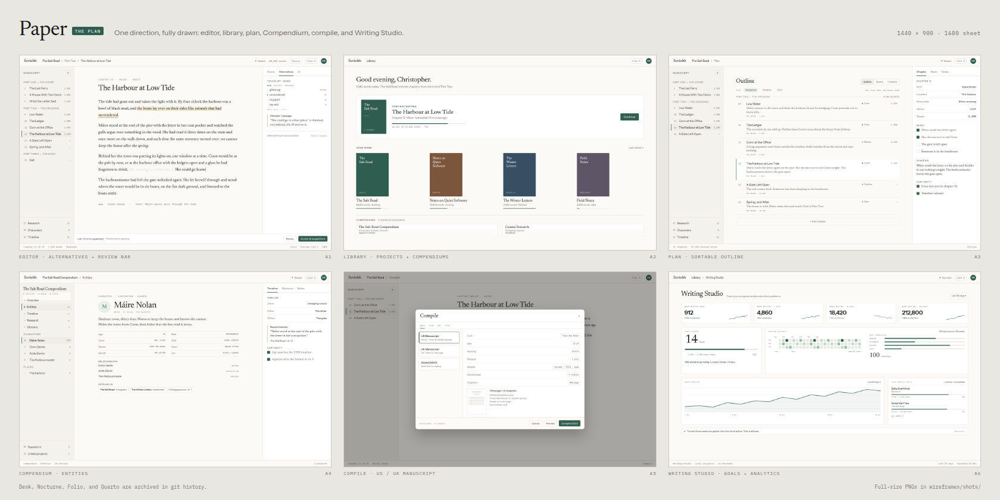
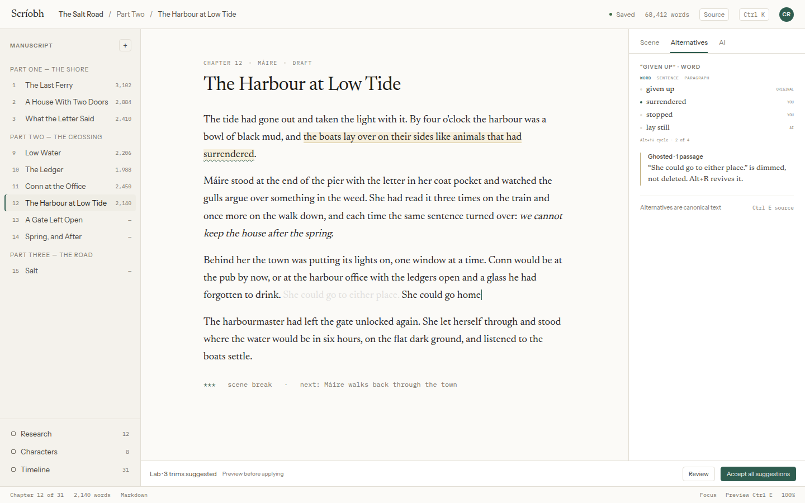
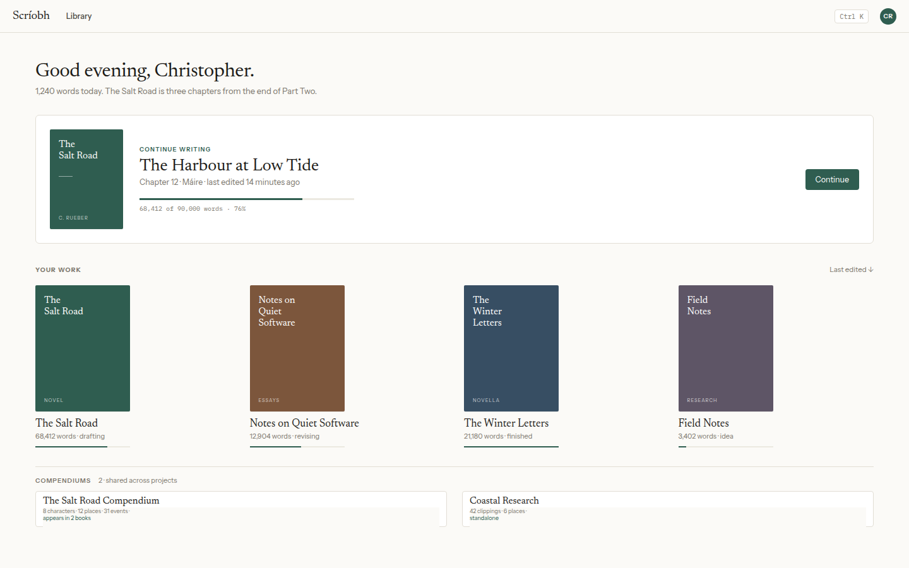
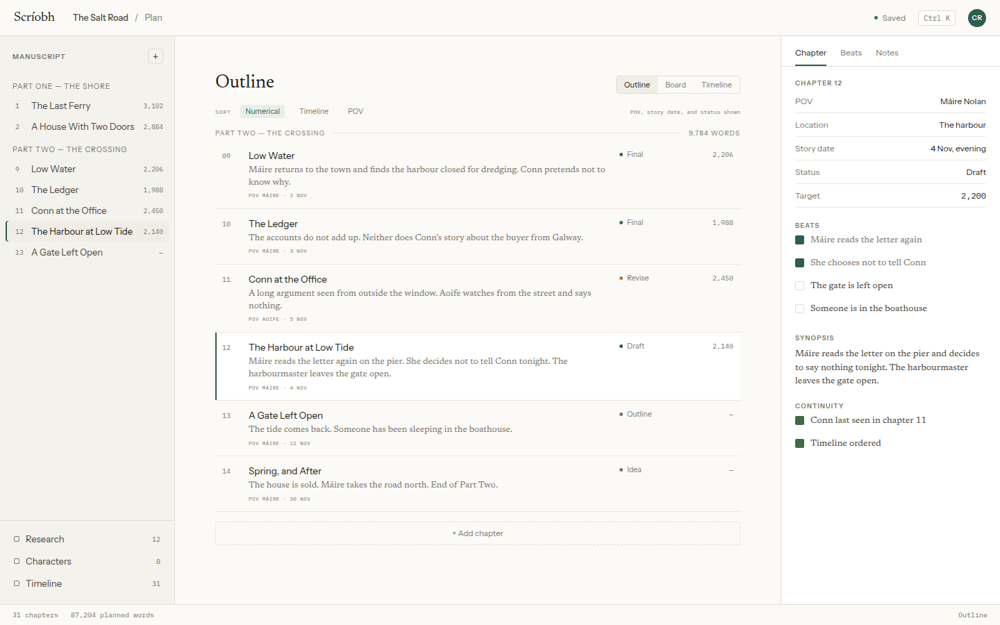
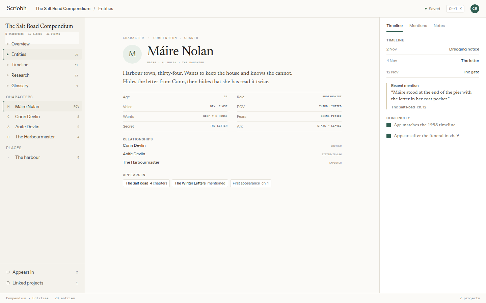
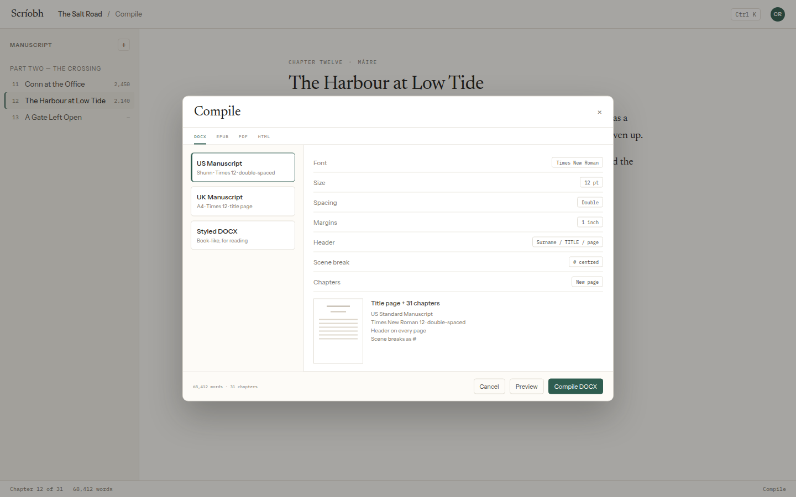
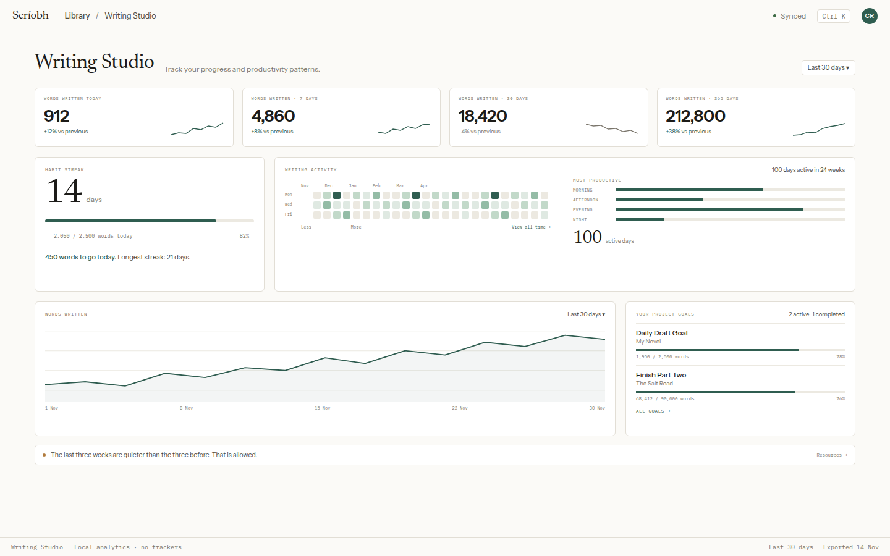
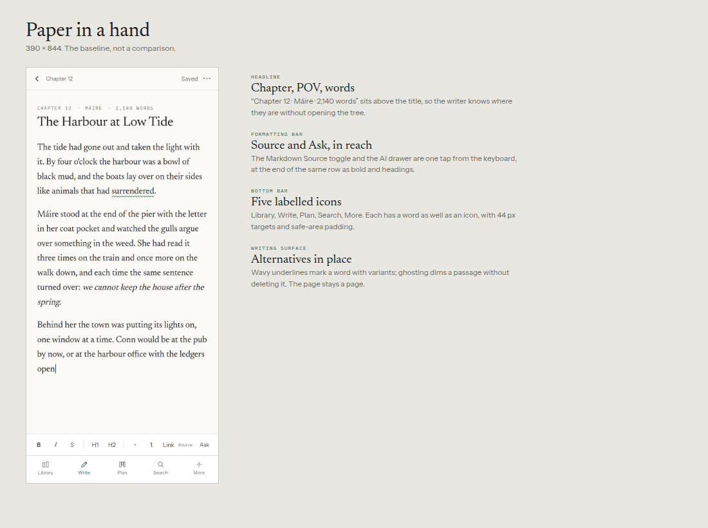

# Wireframes: Paper

**Paper is the plan.** Only Paper screenshots are committed here. The other four directions — Desk, Nocturne, Folio, and Quarto — are archived at the tag `archive/wireframes`.

The sheets show the current plan: rich text with a Markdown **Source** toggle, **alternatives** and ghosting, **Compendiums** beside projects, a **sortable outline**, a **batch accept** for suggestions, and the **manuscript compile** dialog.

## Editor

Alternatives live in the inspector. Wavy underlines mark a word with variants; ghosting dims a passage without deleting it. The review bar carries **Accept all suggestions**, applied as one revision.

## Library

Projects above, Compendiums below. A Compendium can exist without a project and can be shared by several books.

## Plan

The outline sorts by **numerical order, timeline, or POV**, with POV and story date visible on every row.

## Compendium

A first-class workspace: entity list, character sheet, relationships, appears-in, mentions, timeline, and continuity.

## Compile

US Standard Manuscript (Shunn) and UK presets, Times or Courier, double spacing, running header, chapter breaks, `#` scene breaks, and real Word styles.

## Writing Studio

Daily and weekly goals, a habit streak, a 24-week activity calendar, four period cards with deltas and sparklines, a words-written chart, project goals, gentle nudges, and a private progress card. Every number is computed locally. The reference screenshots are in [`docs/reference/novlr-writing-studio/`](../docs/reference/novlr-writing-studio/).

## In a hand

Chapter, POV, and word count above the title. Source and Ask in the formatting bar. Five labelled icons at the bottom: Library, Write, Plan, Search, More.

## Not drawn yet

Still to draw: the **stash panel**, the full **Timeline** and **Research** rooms inside a Compendium, the **Lab** review flow, and the **agent/CLI** surfaces.

## How these were made

- Hand-written HTML and CSS. No framework, no build step.
- Fonts: Newsreader, Instrument Sans, IBM Plex Mono, Courier Prime, all OFL, self-hosted in `fonts/`.
- Screenshots: headless Chromium at the exact artboard size, DPR 1 (desktop) or 2 (mobile).
- Regenerate with `./shoot.sh` (needs Chromium and Python 3).
- View any screen live: `python3 -m http.server 8123` in this folder, then open `a.html?v=editor`, `a.html?v=compendium`, `a.html?v=compile`, and so on.

Sample prose, names, and project titles are fictional and exist only to make the layouts honest.
